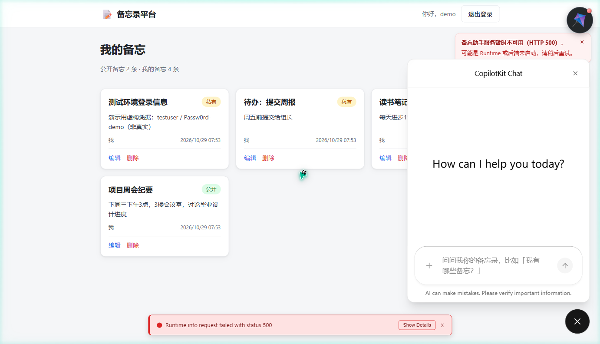

# Memo Platform · 前端

备忘录平台的前端项目，基于 **React 18 + Vite + TypeScript**。

## 功能

- 游客模式：无需登录即可浏览「公开」备忘
- 登录 / 注册（账号密码 + JWT）
- 登录后可新建 / 编辑 / 删除备忘
- 备忘可见性：公开（所有人可见）/ 私有（仅作者本人可见）
- **备忘 Agent**（第三天新增）：登录后右下角出现「备忘助手」，可对话查询自己的备忘录

## 技术栈

- React 18 + TypeScript
- Vite 5（开发服务器 + 构建）
- 原生 `fetch` 对接后端 REST API
- CopilotKit（Agent 聊天 UI）+ CopilotKit Runtime（Node Express）

## 快速开始

```bash
# 安装依赖
npm install

# 启动开发服务器（默认 http://localhost:5173）
npm run dev

# 构建生产包
npm run build
```

## 备忘 Agent（第三天）

备忘 Agent 采用 CopilotKit 三层架构：**前端 → Runtime → Python Agent**。

```text
浏览器 (React + CopilotKit)
  → Vite 代理 /api/copilotkit
    → CopilotKit Runtime (Node Express, localhost:3000)
      → HttpAgent (AG-UI)
        → Python /agent (memo-backend, Agent Framework + DeepSeek)
```

### 启动 Agent（三个服务）

```bash
# 1. Python 后端（memo-backend，端口 8000）
uvicorn app.main:app --reload --port 8000

# 2. CopilotKit Runtime（本仓库，端口 3000）
npm run runtime

# 3. 前端开发服务器（端口 5173）
npm run dev
```

### 认证与安全

- 前端登录后，JWT 通过 `headers.authorization` 传给 Runtime；Runtime 默认转发 `authorization` header 给 HttpAgent → Python `/agent`
- Python 后端校验 JWT，未登录 / 无效 token 返回 401（在运行模型前拒绝）
- Agent 工具只读取后端从 JWT 解析出的 user_id，模型与浏览器都无法指定用户
- Agent 仅在登录后渲染（`user && <AgentChat/>`），后端鉴权兜底

### 会话行为

- 聊天窗口（CopilotPopup）自带**「新建对话」**按钮，点击会清空当前会话的上下文、开启新对话
- 会话上下文由 CopilotKit **每次请求携带完整 `messages` 历史**给后端；后端未配置服务端快照存储，**刷新页面即丢失历史**（换标签页/换设备同样丢失）
- 注意：这里容易误解——**不是**服务端记住会话，而是前端把历史带过去。第四天补充用例 R01 验证过：只发新消息模型无法回忆上一轮，带上历史才能
- 退出登录后 Agent 入口隐藏，本地 token 清除，重新登录会回到全新会话

### 实际版本

- `@copilotkit/react-core` 1.83.0、`@copilotkit/runtime` 1.83.0、`@ag-ui/client` 1.0.3
- Runtime 用 `@copilotkit/runtime/v2` + `createCopilotExpressHandler`（Express 5）

## Agent 评测与优化（第四天）

第四天的主体工作是后端（评测 + 优化），前端**补了一处失败兜底提示**，其余沿用第三天的 CopilotKit / AG-UI 接入方式。用户能感知到的变化：

| 场景 | 优化前 | 优化后 |
| ---- | ---- | ---- |
| 请求含糊（"帮我找一下那个东西"） | 一次性列出全部备忘录 | 先用一句话追问是哪一个 |
| 要求删除 / 修改 | 说明只读，但多余查了一次数据 | 直接说明只读，不发起任何查询 |
| 查询出错 | 模型可能重复再试一次 | 只尝试一次，直接告知失败 |
| Agent 服务不可用 | 只有用户消息，界面无任何回应，像"卡住" | 右上角提示「备忘助手服务暂时不可用」并给出排查方向 |

### 失败状态提示（第四天新增）

CopilotKit v2 **没有暴露会话级错误回调**（类型定义里没有公开的 `onError`），Runtime 或后端挂掉时面板会静默无响应。因此 `src/components/AgentChat.tsx` 里额外做了一层拦截：监听发往 `/api/copilotkit` 的请求，把失败翻译成可读中文提示（401 → 登录失效；5xx → 服务不可用；网络错误 → 无法连接），并在请求成功后自动清除。



> 截图里下方英文红条是 CopilotKit 自带的运行时状态条，没有公开配置可关闭，属于框架 UI；上方中文提示是本项目补充的。

- 评测用例与运行方式（后端仓库）：`memo-backend/tests/agent/`
- 优化记录（基线、改动、前后对比、限制）：`memo-backend/docs/day-4-agent-optimization.md`
- 结果：同一套 12 个用例，通过 **10/12 → 12/12**，工具调用正确 **4/5 → 5/5**；另补 6 个覆盖用例 6/6

## 容器启动（Docker）

```bash
# 1. 创建共享网络（与后端仓库共用，只需一次）
docker network create memo-network

# 2. 在本仓库目录启动（frontend + runtime 两个服务）
docker compose up -d --build
```

- 前端 nginx：`http://localhost:8080`
- Runtime：`http://localhost:3000`
- 前端经 nginx 反向代理：`/api/copilotkit` → runtime（`http://runtime:3000`）、`/api` → backend（`http://backend:8000`）
- Runtime 的 `AGENT_URL` 指向共享网络中的后端 `http://backend:8000/agent`

> 需先启动后端 `memo-backend`，且两者在同一个 `memo-network` 网络。
> ⚠️ 本机当前未安装 Docker，容器配置**尚未实际验证**，安装 Docker 后按上述步骤即可复现。

## 与后端联调

开发环境通过 Vite 代理转发请求（见 `vite.config.ts`）：
- `/api/copilotkit` → CopilotKit Runtime（`localhost:3000`）
- `/api/*` → 后端（`http://127.0.0.1:8000`，去掉 `/api` 前缀）

## 目录结构

```
src/
├── main.tsx            # 入口
├── App.tsx             # 全局布局与登录态管理
├── api.ts              # 后端 API 封装（含 JWT 头注入）
├── types.ts            # 类型定义
├── styles.css          # 全局样式
└── components/
    ├── AuthModal.tsx   # 登录 / 注册弹窗
    ├── MemoBoard.tsx   # 备忘列表
    ├── MemoEditor.tsx  # 新建 / 编辑表单
    └── AgentChat.tsx   # 备忘 Agent（CopilotKit Provider + Popup）

runtime/
└── server.ts           # CopilotKit Runtime（Express + HttpAgent）
```
